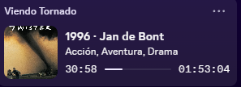
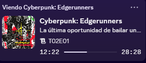
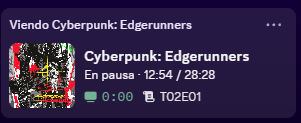

# Butaca

[](https://github.com/Alexxlml/butaca/releases/latest)
[](https://github.com/Alexxlml/butaca/releases)
[](https://github.com/Alexxlml/butaca/releases/latest)
[](LICENSE)


[English](README.md) | **Español** | [Français](README.fr.md) | [Deutsch](README.de.md) | [Italiano](README.it.md)

**Discord Rich Presence para Kodi (no oficial).** Butaca muestra en tu perfil de Discord lo que estás viendo en *cualquier* Kodi de tu red local (un CoreELEC, un Android TV, una Raspberry Pi…) como una tarjeta "Viendo …".

<p>
  
  &nbsp;
  
  &nbsp;
  
</p>

*Tarjetas de una película, un episodio y un episodio en pausa. Discord muestra el título, el póster, la barra de progreso y, en los episodios, la temporada y el número de episodio.*

## ¿Por qué corre en la PC y no en Kodi?

Discord solo expone su interfaz de Rich Presence en el equipo donde se ejecuta. Por eso Butaca corre en tu PC con Windows, le pregunta a Kodi por la red qué está reproduciendo y lo publica en el Discord local. Kodi no se modifica en absoluto.

Es un único `.exe` pequeño (sin instalador, sin .NET ni otro runtime) que vive en la bandeja del sistema.

## Características

- Funciona con cualquier Kodi al que llegue tu PC; no necesita ningún addon de Kodi.
- Tarjetas de película, episodio y "otro video", con póster, barra de progreso y estado de pausa.
- Botones **Buscar Kodi en la red** (mDNS/Zeroconf) y **Probar conexión**.
- **Actualización instantánea:** Butaca escucha las notificaciones de Kodi (WebSocket, puerto 9090), así que reproducir, pausar o avanzar se refleja en Discord al instante. Si ese puerto no está disponible, revisa cada pocos segundos.
- Clave opcional de [TMDb](https://www.themoviedb.org/) para póster, año y directores cuando Kodi no los tiene.
- Interfaz y texto de Discord en 5 idiomas: English, Español, Français, Deutsch e Italiano.
- Inicio con Windows (opcional), instancia única, log con rotación y cambios de configuración sin reiniciar.
- La contraseña de Kodi se guarda en el **Administrador de credenciales de Windows**, no en un archivo.
- Sin telemetría, sin cuentas y sin anuncios.

## Tipos de medios compatibles

| Tipo de medio | Qué muestra Discord |
|---|---|
| Películas | Título, año y director, géneros, póster, barra de progreso |
| Episodios de series | Serie, título del episodio, temporada y número de episodio, póster, barra de progreso |

Otros archivos de video muestran una tarjeta básica con el título.

## Instalación

Butaca necesita **Windows 10 u 11 (x64)** y la **aplicación de escritorio de Discord** (no la versión web).

1. Descarga `Butaca-vX.Y.Z-x64.exe` desde la [página de Releases](https://github.com/Alexxlml/butaca/releases/latest).
2. *(Opcional)* Comprueba la descarga con el archivo `.sha256` publicado junto a ella:
   ```powershell
   Get-FileHash .\Butaca-vX.Y.Z-x64.exe -Algorithm SHA256
   ```
3. Guarda el `.exe` donde quieras y ábrelo. La primera vez se abre sola la ventana de configuración.

> **Windows SmartScreen:** el ejecutable no está firmado digitalmente, así que Windows puede mostrar un aviso de "protegió su PC". Elige *Más información → Ejecutar de todas formas* si confías en la descarga (compara el SHA-256 de arriba o compílalo tú, como se explica más abajo).

## Configurar Kodi

En Kodi, ve a **Ajustes → Servicios → Control** y activa:

- **Permitir el control remoto vía HTTP** (puerto `8080` por defecto).
- **Define un usuario y una contraseña.** Kodi te avisa de esto al activar el control remoto; síguelo. Si no, cualquiera en tu red podría controlar tu Kodi. Butaca guarda la contraseña en el Administrador de credenciales de Windows.
- **Permitir el control remoto desde aplicaciones en otros sistemas.**
- *(Solo para el botón "Buscar Kodi en la red")* **Anunciar estos servicios a otros sistemas.**

Después, en la configuración de Butaca escribe la IP de tu Kodi (o pulsa **Buscar Kodi en la red**), el usuario y la contraseña, y pulsa **Probar conexión**. Guarda y listo.

Butaca nunca cambia los ajustes de Kodi. Se probó con Kodi 22 en CoreELEC.

La actualización instantánea usa el WebSocket de Kodi en el puerto `9090`, que se activa junto con el control remoto desde otros sistemas. **Probar conexión** te dice si está disponible; si no lo está, Butaca sigue funcionando con sondeo. Para desactivarlo o cambiar el puerto, edita `use_websocket` y `websocket_port` en `config.json`.

## Uso

- Butaca corre en la **bandeja del sistema**. Haz doble clic en el ícono para abrir la configuración.
- Clic derecho en el ícono para el menú: estado, Configuración…, Pausar/Reanudar presencia, Abrir carpeta de logs, Buscar actualizaciones…, Acerca de (muestra la versión instalada) y Salir.
- Al salir, se limpia tu estado de Discord.
- Si abres Butaca por segunda vez, solo muestra la configuración de la que ya está corriendo.

**Configuración**

| Opción | Qué hace |
|---|---|
| Dirección, puerto, usuario y contraseña de Kodi | Cómo llegar a Kodi. La dirección está vacía hasta que la escribas. |
| API key de TMDb (opcional) | Mejores pósters, año y directores. [Consigue una gratis](https://www.themoviedb.org/settings/api). |
| Iniciar con Windows | Añade Butaca a las aplicaciones de inicio de tu usuario. |
| Mostrar estado cuando no se reproduce nada | Muestra una tarjeta neutra mientras Kodi está inactivo. Apagada por defecto (se limpia el estado). |
| Idioma | English, Español, Français, Deutsch o Italiano. Cambia la interfaz **y** el texto que Butaca publica en Discord (por ejemplo "En pausa" o "Temporada 01, episodio 05"). Por defecto: inglés. |

Los archivos están en `%APPDATA%\Butaca\`: `config.json` (sin la contraseña) y `butaca.log` (con rotación, 1 MB × 3).

## Actualizar y desinstalar

**Actualizar:** menú de la bandeja → *Buscar actualizaciones…* abre la página de la última versión. Descarga el nuevo `.exe`, cierra Butaca (menú de la bandeja → Salir) y reemplaza el archivo anterior. Tu configuración se conserva. Compara la versión que muestra *Acerca de* con la de la página de Releases.

**Desinstalar:** desmarca *Iniciar con Windows* en la configuración, cierra Butaca y borra el `.exe`. Para no dejar rastro, borra también la carpeta `%APPDATA%\Butaca\` y, si guardaste una contraseña de Kodi, la entrada `kodi-password.Butaca` en el *Administrador de credenciales* de Windows.

## Cómo se elige el póster

1. El arte que Kodi ya tiene, si es una URL `https` pública.
2. [TMDb](https://www.themoviedb.org/), si pones una API key.
3. El ícono propio de Butaca.

Discord no puede mostrar rutas locales ni arte `smb://`, así que se omiten. Las URL de los pósters las descarga Discord, no Butaca.

## Privacidad y seguridad

- Butaca se comunica con: tu Kodi (HTTP y WebSocket en tu red local), Discord (IPC local en tu PC) y, **solo si pones una clave**, con TMDb.
- Lo que ves se publica en tu perfil de Discord, como hace Rich Presence por diseño. Usa *Pausar presencia* en el menú de la bandeja para detenerlo.
- La contraseña de Kodi va en el Administrador de credenciales de Windows. La clave de TMDb se guarda en `config.json` en texto plano; es una clave gratuita ligada a tu propia cuenta.
- El inicio de sesión HTTP de Kodi viaja sin cifrar por tu red. Mantén el control remoto de Kodi dentro de tu red doméstica y nunca lo expongas a internet.
- El binario no contiene ninguna API key; el único valor incluido es el ID público de la aplicación de Discord.

## Solución de problemas

| Síntoma | Qué revisar |
|---|---|
| "Discord no está abierto" | Abre la app de **escritorio** de Discord con tu sesión iniciada. Butaca y Discord deben correr con el mismo usuario de Windows y el mismo nivel de privilegios (ambos normales, no "como administrador"). |
| "Esperando a Kodi" | Kodi está apagado, en reposo o la dirección es incorrecta. Usa **Probar conexión**. |
| "Usuario o contraseña incorrectos" | Usa las credenciales de *Servicios → Control* en Kodi. |
| "Buscar Kodi" no encuentra nada | Activa *Anunciar estos servicios a otros sistemas* en Kodi o escribe la IP a mano. |
| No aparece nada en Discord | En Discord, *Ajustes → Privacidad de actividad* → *Compartir mi actividad* debe estar activado. |

El log (menú de la bandeja → *Abrir carpeta de logs*) registra cada cambio de estado.

## Compilar desde el código

Necesitas [Rust](https://rustup.rs/) (estable, toolchain MSVC) y el SDK de Windows.

```powershell
git clone https://github.com/Alexxlml/butaca.git
cd butaca
cargo build --release
```

El ejecutable queda en `target\release\butaca.exe`. Con `cargo test` corres las pruebas unitarias.

## Próximamente

- Descargar e instalar las actualizaciones desde la propia app.

## Legal

Kodi® is a registered trademark of the XBMC Foundation. Discord is a trademark of Discord Inc. This project is not affiliated with, endorsed by, or sponsored by either.

This product uses the TMDB API but is not endorsed or certified by TMDB.

Butaca se distribuye bajo la [licencia MIT](LICENSE). Las licencias de terceros están en `THIRD-PARTY-LICENSES.txt`, que se publica con cada versión.

## Créditos

- El protocolo IPC de Discord sigue a [service.discord.richpresence](https://github.com/Hiumee/service.discord.richpresence) de Hiumee (MIT).
- La experiencia de app en la bandeja se inspira en [AMWin-RP](https://github.com/PKBeam/AMWin-RP).
